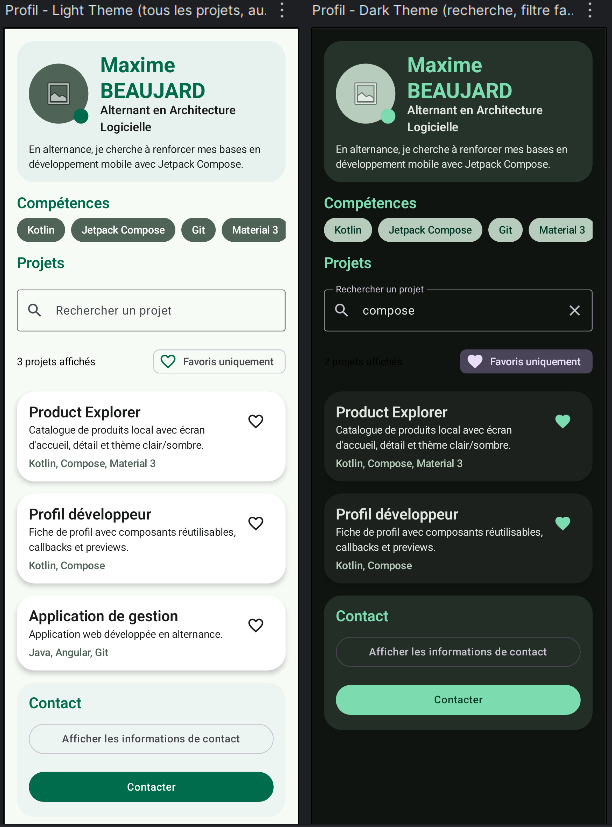

# Profil développeur interactif

## Description

Cette application Android, écrite avec **Jetpack Compose** et **Material Design 3**, est un petit portfolio interactif : elle présente le profil d'un développeur (le mien : alternant en Architecture Logicielle) et ses projets.

Par rapport à la version précédente, l'utilisateur peut maintenant :

- **rechercher un projet** par titre, description ou technologie ;
- **marquer un projet comme favori** (icône cœur sur chaque carte) ;
- **afficher uniquement les projets favoris** (puce « Favoris uniquement ») ;
- **voir le nombre de projets affichés** (« 1 projet affiché », « 3 projets affichés ») ;
- **afficher ou masquer les informations de contact** (état local).

La liste et le compteur se mettent à jour automatiquement à chaque action. Les données restent **locales** : elles sont écrites dans le code Kotlin (`sampleDeveloper()`, `sampleSkills()`, `sampleProjects()`). L'application n'utilise ni API distante, ni Room, ni Navigation, ni persistance.

## États gérés par l'application

| État | Type | Géré par | Rôle |
|---|---|---|---|
| `searchQuery` | `String` | `ProfileViewModel` | Texte saisi dans le champ de recherche |
| `showOnlyFavorites` | `Boolean` | `ProfileViewModel` | Filtre « favoris uniquement » activé ou non |
| `favoriteProjectIds` | `List<Int>` | `ProfileViewModel` | Identifiants des projets favoris |
| `projects` | `List<ProjectUi>` | `ProfileViewModel` | Liste affichée, filtrée par la recherche et par le filtre favoris |
| `showContactInfo` | `Boolean` | `ContactSection` (état local) | Informations de contact affichées ou masquées |

Les quatre premiers sont regroupés dans une seule classe, `ProfileUiState`. Le nombre de projets affiché est calculé à partir de `projects.size`.

## État local

> Quel état avez-vous conservé directement dans un composable et pourquoi ?

J'ai gardé `showContactInfo` directement dans le composable `ContactSection`, avec `rememberSaveable { mutableStateOf(false) }`.

C'est un état purement visuel : il décide seulement si les informations de contact sont visibles. Aucun autre élément de l'écran n'en dépend, et il n'influence ni la recherche, ni les favoris, ni la liste. Il n'a donc pas besoin d'être dans le `ViewModel`. J'ai utilisé `rememberSaveable` plutôt que `remember` pour que l'affichage soit conservé quand l'écran est recréé, par exemple lors d'une rotation.

## State Hoisting

> Pourquoi votre composable d'écran principal peut-il être considéré comme stateless ?

`ProfileScreen` ne stocke aucun état principal : il ne contient ni `remember`, ni `mutableStateOf`, ni référence au `ViewModel`. Il reçoit tout ce qu'il affiche sous forme de **paramètres** (`projects`, `searchQuery`, `showOnlyFavorites`, `favoriteProjectIds`…) et il signale les actions de l'utilisateur avec des **callbacks** (`onSearchQueryChange`, `onToggleFavoriteFilter`, `onFavoriteClick`, `onContactClick`).

Il ne décide donc pas comment l'état est stocké : les valeurs viennent du `ViewModel` via `ProfileContainer`. C'est aussi ce qui permet d'utiliser `ProfileScreen` directement dans les previews, sans `ViewModel`.

## ViewModel

> Quel est le rôle de votre ViewModel dans cette application ?

`ProfileViewModel` gère l'état principal de l'écran et les actions qui le modifient :

- il garde la liste complète des projets (`allProjects`) et l'état de l'écran (`ProfileUiState`) ;
- il calcule la liste affichée avec `filterProjects()`, selon la recherche et le filtre favoris ;
- il expose trois actions : `onSearchQueryChange`, `onToggleFavoriteFilter` et `onFavoriteClick`.

Il ne dépend d'aucun composant Compose. Quand un favori est ajouté ou retiré, il recalcule aussi la liste affichée : en mode « favoris uniquement », un projet retiré des favoris disparaît donc immédiatement de la liste.

## StateFlow

> Comment l'interface est-elle informée lorsqu'un état change ?

Le `ViewModel` contient un `MutableStateFlow<ProfileUiState>` privé (`_uiState`) qu'il est le seul à modifier. Il expose une version en lecture seule, `uiState: StateFlow<ProfileUiState>`, que l'interface peut seulement observer.

Quand l'utilisateur agit (il tape dans la recherche, clique sur un cœur…), l'écran appelle un callback, qui appelle une fonction du `ViewModel`. Celle-ci crée un nouvel état avec `_uiState.update { it.copy(...) }`. Le `StateFlow` publie alors ce nouvel état.

Dans `ProfileContainer`, `collectAsState()` observe le `StateFlow` et le transforme en état Compose. À chaque nouvelle valeur, Compose recompose les composables concernés, et l'écran affiche la nouvelle liste, le nouveau compteur et les favoris à jour.

```
Action utilisateur → callback → ProfileViewModel (update) → StateFlow publie
→ collectAsState() dans ProfileContainer → ProfileScreen recomposé
```

## Organisation du code

Tout le code est dans `MainActivity.kt` ; le thème est dans `ui/theme/`.

| Élément | Rôle |
|---|---|
| `ProfileUiState` | Classe de données qui représente l'état complet de l'écran |
| `ProfileViewModel` | Gère l'état avec un `StateFlow` et fournit les actions (recherche, filtre, favoris) |
| `ProfileContainer` | Récupère le `ViewModel`, collecte le `StateFlow` et connecte l'état et les callbacks à l'écran |
| `ProfileScreen` | Écran stateless : assemble les sections dans une `LazyColumn` |
| `ProfileHeader`, `AvatarWithBadge` | En-tête avec avatar, badge, nom, rôle et description |
| `SkillsSection`, `SkillChip` | Compétences dans une `LazyRow` |
| `ProjectCard` | Carte d'un projet avec le bouton favori |
| `ContactSection`, `ContactField`, `ContactButton` | Zone de contact avec son état local et le bouton « Contacter » |
| `projectCountLabel()` | Texte du compteur, avec le singulier ou le pluriel |
| `MainActivity` | Point d'entrée : applique le thème et affiche `ProfileContainer` |

## Previews

Deux previews utilisent directement `ProfileScreen`, sans `ViewModel`, avec des états différents :

- `ProfileScreenLightPreview` : thème clair, recherche vide, tous les projets, aucun favori ;
- `ProfileScreenDarkPreview` : thème sombre, recherche « compose », filtre favoris activé, deux projets favoris.

## Capture d'écran


